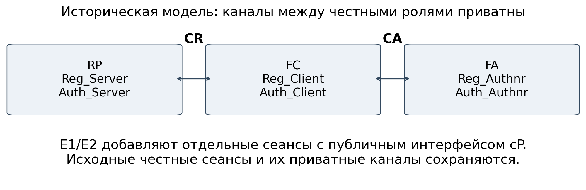
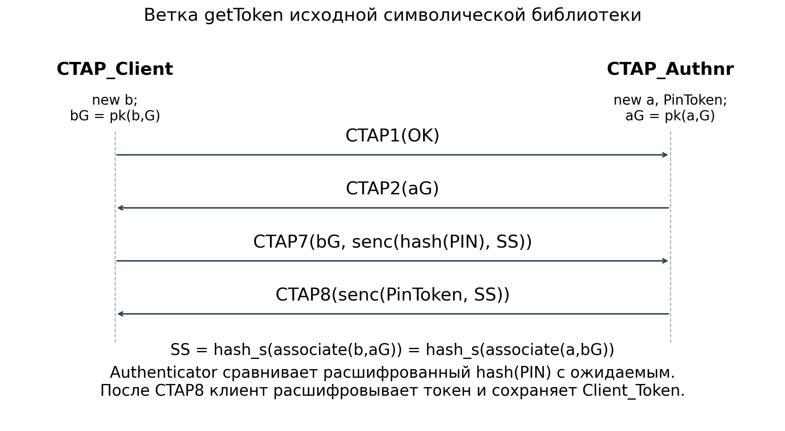
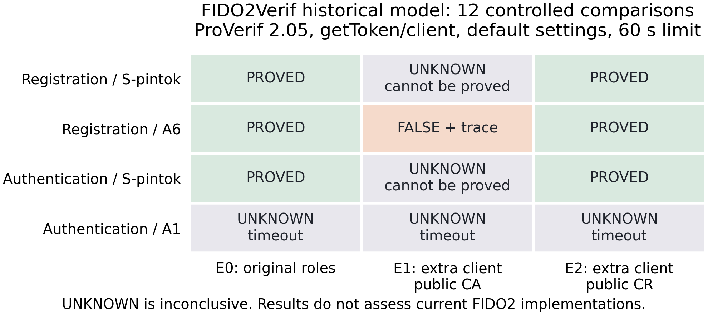

# Разработка программных средств для экспериментального анализа безопасности протокола FIDO2 на основе FIDO2Verif

**GENERATED DRAFT.** Вспомогательный черновик для проверки и самостоятельной доработки студентом и руководителем. Теоретические положения опираются на перечисленные первоисточники. Результаты запусков должны подтверждаться каталогами raw; ожидания не являются измерениями. Модель 2022 года не объявляется моделью всех современных реализаций FIDO2.

## Сведения для оформления

Титульный лист и проект индивидуального задания вынесены в отдельные страницы Word/PDF по приложениям 1–2 методички БГУ. В оформленных файлах есть автоматическое оглавление с проверенными страницами. Личные реквизиты, даты и подписи оставлены незаполненными. Этот Markdown содержит исходный текст; текущая вёрстка проверяется по PDF.

## Перечень обозначений

RP — relying party, сторона, предоставляющая сервис; FC — FIDO client в обозначениях статьи; FA — FIDO authenticator; CTAP — Client to Authenticator Protocol; UV — user verification; UP — user presence; PIN — персональный код пользователя; HMAC — код аутентификации сообщения на основе хеш-функции; ECDH — согласование ключа на эллиптической кривой; correspondence — свойство соответствия событий; raw — полный исходный журнал запуска.

## Введение

Распространение аутентификации с открытым ключом меняет распределение доверия между сервисом, браузером и средством подтверждения действий пользователя. Вместо проверки общего секрета сервер проверяет подпись над данными операции. Однако безопасность системы определяется не только стойкостью подписи. Необходимо установить, к какому сервису относится операция, кто сформировал запрос, какая проверка пользователя выполнена и может ли промежуточный компонент использовать действительный ответ вне ожидаемого контекста [11].

FIDO2 объединяет web-интерфейс WebAuthn и взаимодействие платформы с аутентификатором через CTAP. Эти уровни имеют разные обязанности и разные границы доверия. Изолированная проверка криптографического примитива не доказывает согласованность всего обмена. Поэтому существенны формальные модели, связывающие действия компонентов и явно описывающие возможности нарушителя [8].

Актуальность исследования обусловлена необходимостью воспроизводить опубликованные выводы без подмены исторической модели современными спецификациями. Статья 2022 года и её открытый код дают основу для контролируемых экспериментов. Вместе с тем исходный инструмент ориентирован на пакетную обработку и использует упрощённую классификацию вывода. Инженерная надстройка должна сохранять первичные данные и позволять независимо проверить каждый итог [4, 8, 10].

**Цель** — исследовать влияние предусмотренных FIDO2Verif предположений о дополнительных сеансах участников на свойства секретности и аутентификации и разработать программные средства воспроизводимого анализа.

**Задачи:** установить происхождение исходников; изучить архитектуру FIDO2 и семантику запросов ProVerif; сопоставить статью и реализацию; воспроизвести ограниченный baseline; реализовать изолированный запуск и консервативный разбор результатов; провести небольшую матрицу сравнений; объяснить ограничения выводов и отличия от современных спецификаций.

**Объект исследования** — историческая символическая модель FIDO2 в FIDO2Verif. **Предмет** — зависимость доказуемости выбранных запросов от состава дополнительных сеансов с публичными интерфейсами. **Методы** — анализ первичных спецификаций и исходного кода, символическая верификация, контролируемый вычислительный эксперимент, сравнение и документирование происхождения данных.

Предшествующие исследования формализовали предположения и цели безопасности FIDO UAF, выявляя минимальные условия выполнения выбранных свойств [6]. Этот опыт полезен методически, однако UAF и FIDO2 являются разными протоколами: результаты одного не заменяют проверку другого.

Структура пояснительной записки включает введение, основную часть, заключение, список источников и приложения в соответствии с методическими рекомендациями БГУ [1].

Практическая значимость состоит в получении проверяемого процесса исследования: модель, команда, версия инструмента и полный вывод сохраняются совместно. Собственный вклад ограничен инженерной автоматизацией и самостоятельным анализом результатов. Авторство исходной модели, запросов и опубликованных атак принадлежит авторам FIDO2Verif [4, 8].

## Глава 1. Теоретические основы FIDO2

### 1.1. Архитектура FIDO2

В WebAuthn участвуют пользователь, relying party, клиентская платформа и аутентификатор. RP задаёт параметры регистрации или аутентификации и проверяет ответ. Платформа реализует web API и связывает запрос страницы с допустимым контекстом. Аутентификатор создаёт либо использует credential и формирует криптографический ответ. Эти обязанности важно различать: наличие подписи доказывает использование ключа, но само по себе не устанавливает корректность всех решений браузера и сервера [11, §5–7].

Пара ключей относится к credential в контексте RP. Сервер хранит публичный ключ и связанные сведения, необходимые для проверки. Приватный ключ используется аутентификатором в рамках принятой политики хранения и проверки пользователя. Современный WebAuthn учитывает возможность backup credentials; поэтому общее утверждение «ключ никогда не покидает единственное физическое устройство» не подходит для описания всех вариантов [11, §6.1.3].

В исторической статье FC, FA и RP представлены отдельными ролями. Между FC и FA предполагается канал CA, а между FC и RP — CR. В коде оба канала приватны; возможности нарушителя расширяются дополнительными ролями, взаимодействующими через публичный cP. Такая конструкция позволяет сравнивать предположения о доверии, но требует осторожного перехода от символической роли к реальному браузеру, ОС или USB-каналу [4, FIDO2.pvl; 8, §3].

### 1.1.1. Границы доверия и распределение состояния

Для анализа архитектуры полезно разделить владение данными, возможность вычислять сообщения и право принимать решение об успешной операции. RP владеет записью о зарегистрированном credential и решает, соответствует ли ответ ожидаемому запросу. Клиент получает параметры от RP, формирует клиентские данные и передаёт запрос аутентификатору. Аутентификатор работает с секретным материалом и возвращает криптографически связанный ответ. Участник, который пересылает сообщение, не обязательно является владельцем ключа, которым оно защищено. Поэтому доверие к клиенту и доверие к аутентификатору представляют разные предпосылки [4, 11].

| Компонент | Существенное состояние в модели | Основная обязанность |
|---|---|---|
| RP | Server_Reg_Record с credential ID, публичным ключом и counter | Проверить ответ относительно собственного challenge и сохранённой записи |
| FC | Client_Token и параметры текущего обмена | Связать запрос RP с операцией authenticator и переслать результат |
| FA | Authnr_Token, credential private key либо данные для его восстановления | Проверить запрос, выполнить подпись и породить событие завершения |
| Публичная сеть | Доступные нарушителю сообщения cP | Среда для наблюдения и формирования сообщений нарушителем |



В такой схеме приватность CA и CR является формальным допущением, а не результатом проверки TLS или IPC. Если криптографический механизм канала не представлен процессами и сообщениями, ProVerif не анализирует его установление. Инструмент использует уже объявленную приватность имени канала. Следовательно, результат не распространяется на ошибки настройки TLS, доверенных сертификатов или доступа к IPC. Эти механизмы могли бы стать объектом другой модели, но отсутствующие процессы нельзя восстановить из одного атрибута private.

Дополнительная роль с cP меняет именно множество сеансов, которые доступны противнику. В исходной модели остаются честные FC, FA и RP с приватными интерфейсами. Это существенно при чтении E1/E2: верификатор анализирует совместное поведение честных и добавленных сеансов, а не исключительно «повреждённую» копию системы. Воспроизводимый эксперимент должен фиксировать состав обеих частей. Простого названия «скомпрометирован клиент» недостаточно для однозначного восстановления такого процесса.

При переносе результата на реализацию понадобилось бы обосновать соответствие между каждой ролью и конкретными границами защиты. Например, один программный процесс может выполнять несколько логических функций, а один аутентификатор может поддерживать несколько credential. Совпадение названий не устанавливает такое соответствие. В рамках данной работы архитектура используется как средство постановки формальных вопросов: кто способен сформировать ответ, кто располагает состоянием и какое событие означает принятие результата.

### 1.2. WebAuthn

WebAuthn определяет интерфейс создания и получения public-key credentials. При регистрации RP формирует challenge и параметры credential, а клиентская платформа выполняет операцию создания. Полученный результат содержит данные, на основании которых RP проверяет контекст и сохраняет новый публичный ключ. При аутентификации сервер формирует новый challenge, а аутентификатор использует подходящий credential для подписи [11, §5.1, §7].

Challenge связывает ответ с конкретной попыткой и ограничивает повторное использование старых сообщений. RP ID и origin участвуют в установлении контекста. Проверка подписи без соответствующих проверок challenge, origin, RP ID и иных обязательных условий не эквивалентна выполнению нормативного алгоритма WebAuthn. Поэтому в формальной модели следует перечислять не только криптографические операции, но и принятые абстракции обработки запросов [11, §7.1–7.2].

Регистрация отличается от аутентификации состоянием системы. В регистрации ещё устанавливается связь между учётной записью и credential; в аутентификации сервер уже должен располагать ранее зарегистрированным публичным ключом. Нарушение предположений на первом этапе может повлиять на последующие корректные проверки. В FIDO2Verif эти фазы исследуются отдельными моделями: Auth.pv предварительно заполняет таблицы регистрационных данных. Следовательно, успех запроса в Auth.pv не доказывает безопасность процедуры, посредством которой эти записи первоначально появились [4].

### 1.2.1. Регистрация и проверка аутентификационного утверждения

Регистрация создаёт долгоживущую связь между учётной записью и credential. На этом этапе необходимо отличать создание ключа от принятия ключа сервером. Аутентификатор может корректно создать пару ключей и подписать ответ, но безопасность привязки к пользователю дополнительно зависит от того, какой запрос получил RP, каким клиентским контекстом он ограничен и какие условия доверия к ответу приняты. Именно поэтому свойства регистрации в модели выражены событиями нескольких ролей, а не только равенством результатов проверки подписи [8, 11].

В историческом Reg_Server сначала моделируется традиционный вход: принимается Reg1 с user handle и password и проверяется совпадение с ожидаемыми значениями. Затем сервер выдаёт challenge. Это часть условий рассматриваемого сценария, а не утверждение, что всякий современный WebAuthn-сервис обязан предварительно применять пароль. При исследовании регистрации важно указать, каким способом право изменить учётную запись уже подтверждено и что модель считает данными текущего пользователя [4, функция Reg_Server].

После ответа Reg5 сервер конструирует ожидаемый ClientData из challenge, RP ID и абстрактной привязки канала GetTLSBinding(CR). Затем он сравнивает клиентские данные, проверяет хеш RP ID и подпись над набором полей. При выполнении условий создаётся Server_Reg_Record и порождается Server_Finish_Reg. Из этой последовательности видно, что событие означает принятие записи данным процессом сервера. Оно не включает все нормативные проверки браузера, цепочки сертификатов или пользовательского интерфейса, если эти проверки отсутствуют в самом процессе.

Аутентификация опирается на иное исходное состояние. Auth_Server получает сохранённые credential ID, публичный ключ и counter из Server_Reg_Record; проверка подписи использует уже сохранённый xpkau. Поэтому связь, установленная регистрацией, становится предпосылкой последующего анализа. Если рассматривать Auth.pv независимо, необходимо помнить, что таблицы заранее заполнены процессом setup. Нельзя из успешной аутентификации сделать обратный вывод, что произвольная процедура регистрации надёжно сформировала эти записи.

Свежий challenge ограничивает повторное применение готового ответа: подпись должна относиться к данным текущего запроса. Однако одновременные сеансы могут породить более сложный вопрос — не перенаправлен ли новый действительный ответ в другой логический контекст. Для такого анализа следует связывать в событии те идентификаторы и данные, по которым требуется agreement. Проверка свежести, проверка подписи и injective correspondence дополняют друг друга; ни одна из них не заменяет весь набор остальных проверок [9, 10].

WebAuthn Level 3 определяет алгоритмы RP для создания и проверки credentials значительно подробнее, чем рассматриваемая библиотека. Аналитическое сопоставление должно строиться по шагам: как представлена проверка challenge; что заменяет origin; каким термом задан RP ID; как выражены признаки UP/UV; какое состояние сохраняется. Если соответствующего терма, условия или события нет, корректный вывод состоит в том, что аспект абстрагирован либо не покрыт. Молчаливое отождествление ClientData исторической модели с полным набором условий актуального API лишило бы результаты определённой области применимости.

### 1.3. CTAP2

CTAP описывает взаимодействие платформы с аутентификатором. Среди основных операций современной спецификации — authenticatorMakeCredential, authenticatorGetAssertion, authenticatorGetInfo и authenticatorClientPIN. Они определяют формат команд, параметры и допустимое поведение аутентификатора. CTAP не является web API страницы; вызовы WebAuthn и команды CTAP находятся на разных уровнях системы [7, §6].

В FIDO2Verif CTAPType принимает четыре значения: noCTAP, setPIN, chgPIN и getToken. Они выбирают ветви исторического обмена, связанного с PIN и выдачей токена. Совместно с двумя типами хранения credential и тремя режимами транзакций это позволяет авторам статьи охватить 32 комбинации высокого уровня: восемь регистрационных и двадцать четыре аутентификационных [8, §4.1].

Эти 32 комбинации нельзя считать полной моделью текущего CTAP. Современная спецификация содержит больше состояний, опций, механизмов UV, правил permissions и обработки ошибок. Исторический эксперимент отвечает на вопрос о конкретной системе процессов, а не о соответствии реализации всему стандарту. Обновление этой системы требует отдельного исследования, иначе невозможно отделить воспроизведение статьи от разработки новой модели [7, 8].

С точки зрения метода исследования CTAP следует рассматривать как машину состояний. Один и тот же формат команды может обрабатываться по-разному в зависимости от возможностей authenticator, ранее выполненной проверки пользователя и состояния токена. Поэтому состав полей сообщения и допустимость самой операции — разные элементы спецификации. Формальная модель, которая описывает только формат запроса, но не условия его выполнения, не охватывает весь протокол. Аналогично модель с несколькими фиксированными ветвями не становится полной только благодаря наличию константы с названием версии [7].

В исследуемом коде выбор CTAPType сделан статически при генерации входного файла. Он определяет ветви CTAP_Authnr и CTAP_Client, после которых в последующей фазе запускаются Reg_* или Auth_* роли. Таким образом, один запуск ProVerif анализирует уже выбранный вариант протокола, а Python перебирает варианты снаружи. Различать эти уровни необходимо при подсчёте экспериментов: четыре значения CTAPType — это четыре возможные настройки входа, а не четыре независимые проверки внутри любого отдельно сохранённого raw-журнала.

Параметр AuType задаёт исторические варианты хранения credential private key. В client-ветви регистрации библиотека создаёт fresh credential ID и сохраняет приватный ключ в Authnr_Client_Record. В server-ветви credential ID формируется как шифрование кортежа с приватным ключом и контекстными идентификаторами под wrapping key. Поэтому изменение AuType затрагивает способ представления состояния и зависимость секретности credential private key от wrapping key. Это конкретное различие исходников, а не универсальное описание современных категорий аутентификаторов [4, Reg_Authnr].

| Ось модели | Значения | Что меняется | Что не следует автоматически заключать |
|---|---|---|---|
| CTAPType | noCTAP, setPIN, chgPIN, getToken | Выбранная ветвь исторического обмена | Что покрыты все команды текущего CTAP |
| AuType | client, server | Представление credential key и его хранения | Что это platform/cross-platform либо synced/device-bound |
| TrType | empty, simple, generic | Включение и обработка транзакционных данных | Что проверено осознанное согласие пользователя с экранным содержимым |

Основная матрица намеренно фиксирует getToken/client/empty там, где последний параметр применим. Такая фиксация исключает смешение двух причин изменения результата: новых assumptions и другой протокольной ветви. Она одновременно ограничивает выводы. Даже если все запросы выбранной матрицы были бы разрешены, это не означало бы проверки server-side storage либо режимов транзакционной авторизации. Для этих вариантов потребовались бы самостоятельные inputs, а не расширительное толкование уже полученных ответов.

### 1.4. Client PIN и PIN/UV authentication

В исторической модели пользовательский PIN и PinToken выполняют разные функции. PIN участвует в процедуре, после которой аутентификатор выдаёт случайный токен. Клиент использует токен при формировании HMAC, включаемого в последующие операции. Поэтому секретность PIN не равна секретности токена: знание одного секрета и возможности его применения следует анализировать отдельно [8, §3.2].

В коде токен создаётся внутри CTAP_Authnr и сохраняется в Authnr_Token; соответствующая клиентская роль сохраняет полученное значение в Client_Token. Последующие роли извлекают значение из таблиц. Таблицы и фазы представляют связь между этапами обмена. Проверка query secret должна относиться именно к значению, участвующему в обмене: присутствие одноимённого fresh name в шаблоне может сделать выбор идентификатора неоднозначным [4, 10].

CTAP 2.3 использует понятия pinUvAuthToken и pinUvAuthParam. Старый getPinToken помечен как superseded; предусмотрены операции получения токена с permissions через PIN или встроенную UV. Имеются правила состояния и persistent token. Это меняет множество проверяемых условий: «токен раскрыт» ещё не описывает, какие команды он разрешает, с каким RP связан и как долго остаётся действительным [7, §6.5].

UP и UV также необходимо различать. Подтверждение присутствия не тождественно проверке личности локального пользователя, а ни одно из этих условий автоматически не означает осознанного согласия с конкретной транзакцией. В модели agreement должен охватывать именно те данные и события, которые соответствуют заявленному исследовательскому вопросу [11].

### 1.4.1. Реконструкция getToken по исходной библиотеке

Рассмотрим выбранный в матрице getToken без подмены его актуальной командой CTAP 2.3. Роль CTAP_Authnr создаёт fresh PinToken и секретный DH-параметр a; роль CTAP_Client создаёт b. Публичные доли представлены термами pk(a,G) и pk(b,G). Значение PIN передано обеим ролям как параметр setup. Это модель заранее согласованного секрета; реальный ввод PIN, его длина, ограничение числа попыток и измерение энтропии данной конструкцией не задаются [4, CTAP_Authnr и CTAP_Client].



Первый запрос CTAP1(OK) инициирует получение публичной доли authenticator. Ответ CTAP2(aG) позволяет клиенту вычислить SS через associate(b,aG) и hash_s. Клиент шифрует hash(PIN) под SS и отправляет CTAP7 с bG. Authenticator независимо вычисляет associate(a,bG), расшифровывает значение и сравнивает его с hash(PIN). Равенство общих секретов обеспечено объявленным уравнением DH. При успешном сравнении отправляется CTAP8 с зашифрованным PinToken; клиент расшифровывает ответ и сохраняет токен.

Проверяемые условия здесь имеют различную роль. Сравнение хеша показывает владение требуемым PIN в рассматриваемой ветви. Шифрование защищает содержимое относительно знания SS. Ни само уравнение DH, ни возможность вычислить общий секрет не содержит утверждения об идентичности удалённой роли. Если процесс должен доказывать agreement по участникам, эти данные необходимо связать отдельными условиями и событиями. Именно в этом смысле неаутентифицированное согласование ключа представляет отдельный предмет анализа, не сводимый к корректности функции associate [8].

В модели Authnr_Token содержит одну колонку bitstring, как и Client_Token. Идентификатор сеанса, RP ID и права на отдельные команды в сигнатуры этих таблиц не входят. Кроме того, запись authenticator создаётся до завершения сетевого обмена, а клиентская запись — после расшифрования ответа. Это следует из порядка insert в ролях. Такое представление является исследовательской абстракцией состояния. Оно не устанавливает, как современные реализации связывают токен с permissions, RP scope или ограничениями его времени жизни.

У агрегированного запроса S-pintok есть ещё одна существенная особенность. Имя PinToken встречается как fresh name authenticator, как локальное имя setup и как переменная извлечения значения из таблицы. ProVerif разворачивает эти bindings в несколько имён. Следовательно, исходный query охватывает значения, определяемые несколькими конструкциями процесса. Для узкого вопроса о конкретном fresh token потребовалось бы явно выделить соответствующий binding. В данной работе такой новый запрос не выдаётся за исходный C8 и не подставляется вместо него в таблицу результатов.

Современные permissions позволяют поставить более детальные вопросы: какую операцию разрешает полученный токен, как ограничен RP, при каких событиях состояние сбрасывается. Даже доказанная секретность не отвечает на вопрос о допустимом использовании секрета стороной, которой он законно выдан. Поэтому будущая модель pinUvAuthToken должна содержать не только crypto-операции, но и проверяемые переходы состояния. Это расширение формальной постановки, а не простая замена регистра букв в имени переменной [7, §6.5].

### 1.5. Криптографические механизмы

Модель содержит симметричное шифрование, хеширование, HMAC, подписи и символическое согласование DH. Для шифрования задано правило корректного расшифрования известным ключом; для подписи — проверка соответствующим публичным ключом. DH представлен уравнением, выражающим равенство согласованных значений. Эти конструкции задают доступные преобразования термов, а не реализацию вычислений над байтами [4, FIDO2.pvl:22–68].

В символической модели стойкость примитивов принимается как допущение. Нарушитель может применять известные функции к доступным термам, но не получает возможности произвольно обратить идеальную хеш-функцию или извлечь неизвестный ключ из корректного шифротекста. Поэтому отрицательный результат обычно связан с композицией обмена, выдачей данных и условиями доверия. Он не является криптоанализом конкретной библиотеки или алгоритма [10].

Современные PIN/UV Auth Protocol One и Two конкретизируют ECDH, KDF, шифрование и MAC. Protocol Two использует раздельное получение ключевых материалов через HKDF и собственные правила IV. Историческая функция hash_s и идеальный senc не отражают все эти детали. При этом разделение ключей само по себе не доказывает аутентичность другой стороны: это разные требования, которые должны проверяться разными утверждениями [7, §6.5.6–6.5.7].

### 1.5.1. Уравнения, типы и пределы криптографической абстракции

Символическое шифрование удобно проиллюстрировать правилом sdec(senc(m,k),k)=m. Правило разрешает восстановить сообщение при наличии правильного ключа и не задаёт поведение реального алгоритма на уровне блоков, padding или ошибок реализации. Отсутствие других редукций существенно: из senc(m,k) не следует возможность получить m, если у нарушителя нет k или альтернативного пути к m. Поэтому набор объявленных уравнений непосредственно определяет знания, которые может вывести противник [4, 10].

Для подписей в библиотеке существует отдельная пара функций spk и sign и редукция корректной проверки. Публичный ключ может быть известен противнику без знания signing key; это позволяет проверять подпись, но не формировать новые подписи этим ключом. Вместе с тем действительная подпись атакующего собственным ключом не становится подписью доверенного authenticator только из-за успешного checksign. Требование принадлежности проверяемого ключа ожидаемой стороне должно быть обосновано другими частями модели и принятой политикой доверия.

Уравнение DH имеет вид associate(a,pk(b,G))=associate(b,pk(a,G)). Оно выражает коммутативность получения общего значения, но не раскрывает скаляры и не описывает арифметические ошибки. Символ G — параметр типа Gen; дополнительные свойства кривой, проверка публичной точки, cofactor или конкретное представление координат не моделируются этим единственным равенством. Поэтому эксперимент не измеряет стойкость определённой кривой и не подтверждает правильность её реализации на устройстве.

Различие типов также влияет на постановку запросов. В библиотеке ключ симметричного шифрования, signing private key, signing public key и другие объекты имеют разные типы. Значение, подходящее для аргумента одной функции, не всегда допускается как аргумент другой. Такая дисциплина помогает исключить часть некорректных сообщений в самой постановке, но требует проверки того, насколько она соответствует допустимым сообщениям реального протокола. Если реализация принимает более широкий класс байтовых строк, часть поведения может быть исключена типизацией модели [3, 10].

Ограничение криптографического анализа особенно заметно на примере PIN. Fresh name типа bitstring не представляет автоматически четырёх- или шестизначный код, который можно перебирать. Для исследования угадывания пришлось бы задать пространство кандидатов и допустимые проверки либо использовать иной метод оценки. Поэтому из выбранных secrecy queries нельзя вывести оценку необходимого числа попыток или времени подбора пользовательского PIN. Здесь рассматриваются прежде всего логические пути получения данных и согласованность действий участников.

### 1.6. Модель угроз FIDO2

Корректное утверждение о безопасности включает не только свойство, но и возможности противника. Например, приватный канал между честными ролями исключает перехват сообщений в этом сеансе. Дополнительный клиент, работающий через публичный интерфейс, расширяет доступ нарушителя иначе, чем полная публикация канала или утечка приватного ключа. Смешение этих случаев приводит к неправильному объяснению результатов [8, §3.1].

Авторы FIDO2Verif варьируют утечки полей и дополнительные роли. Для регистрации предусмотрены публикации wrapping key и attestation private key. Для аутентификации дополнительно рассматриваются credential private key, counter и credential ID. Отсутствие конкретной публикации не означает, что значение недоступно иным путём: протокол может сам передавать его в сообщении, доступном нарушителю [4].

Исследование не охватывает автоматически побочные каналы, физическое извлечение секрета, ошибки памяти, реальную энтропию PIN и социальную инженерию. Даже доказанное свойство справедливо в рамках объявленных процессов и правил. Практическая ценность модели состоит в явном выявлении зависимостей между предположениями и целями, а не в замене всей оценки безопасности реального продукта [8, 10].

### 1.6.1. Контролируемые допущения и сравнимость сценариев

Для каждого сравнения нужно явно разделять неизменяемые предпосылки и варьируемое условие. В этой работе постоянны версия библиотеки, идеализированные примитивы, выбранные типы протокола, отсутствие явных field leaks и сам security query внутри сравниваемой тройки. Изменяется набор дополнительных ролей. Такое разделение позволяет связывать изменение ответа анализатора с конкретным расширением процесса, а не с одновременной заменой нескольких незафиксированных деталей.

E1 и E2 асимметричны. При E1 генератор добавляет клиента с публичным интерфейсом к authenticator и также CTAP_Client на cP. При E2 добавляется клиент с публичным интерфейсом к RP, без аналогичного дополнительного CTAP-клиента. Следовательно, это не две одинаковые операции «открыть один канал» на разных участках. Интерпретация результата должна включать весь набор вставленных процессов. Наблюдаемую разницу E1/E2 нельзя автоматически приписать только свойствам TLS или только свойствам IPC.

Возможности противника задаются ещё и тем, что публикуется исходно. Идентификаторы и публичные ключи могут быть доступны по назначению протокола. Раскрытие такого значения не является нарушением secrecy, если соответствующая цель для него не ставится. Напротив, значение credential ID или counter может рассматриваться авторами как объект конфиденциальности даже при наличии практических систем, в которых его наблюдаемость допускается. Название свойства следует читать вместе с принятым security goal, а не заменять бытовым смыслом слова «секрет» [8, §3].

Модель не делит реальный мир на два универсальных класса «доверенный компонент» и «скомпрометированный компонент». Она описывает конкретные процессы, доступные сообщения и публикации. Такой подход полезен именно своей точностью: можно показать, какое условие ослаблено и как изменился анализ. Однако для практического вывода потребуется дополнительная аргументация, что рассматриваемое нарушение доверия осуществимо в конкретной системе. Без этого результат остаётся корректным формальным сравнением исторических сценариев.

## Глава 2. Формальная верификация FIDO2

### 2.1. Формальные методы анализа протоколов

Формальная верификация связывает точное описание системы с логическим утверждением. Математическую основу используемого языка процессов даёт applied pi calculus, в котором сообщения строятся из имён и функций с заданными уравнениями [2]. Для протокола задаются сообщения, локальные действия, секреты, события и возможности противника. Затем проверяется, существует ли поведение, нарушающее цель, либо можно доказать её выполнение при всех поведениях модели. В отличие от проверки нескольких успешных обменов, такая постановка допускает произвольное чередование сеансов и действия активного нарушителя [10].

Качество результата зависит от качества утверждения. Секретность ключа, согласованность участников, свежесть операции и неразличимость пользователей — разные свойства. Если в событии отсутствует значимое поле, correspondence не доказывает соглашение по этому полю. Поэтому перед запуском необходимо сопоставить естественно-языковую цель и аргументы формальных событий [8, 10].

Формальная постановка начинается с выбора наблюдаемого поведения. Процессы могут вычислять локальные значения, передавать сообщения, хранить данные и порождать события. Событие верификатора не обязано быть сообщением протокола: это точка наблюдения исследователя, помещённая после тех проверок, которые должны предшествовать заявлению об успешном действии. Если поставить её раньше либо связать с недостаточным набором параметров, формально доказанное свойство будет иметь иной смысл, чем предполагал автор модели [2, 10].

Для воспроизведения научной работы полезна цепочка из четырёх соответствий: естественно-языковая цель → математическое утверждение → синтаксис query → конкретное место event в процессе. Каждое звено требует отдельной проверки. Например, фраза «сервер согласовал регистрационные данные с authenticator» не указывает, какие данные входят в agreement и какие шаги подтверждены. Только полный список аргументов Server_Finish_Reg и Authnr_Finish_Reg делает запрос однозначным. Таблица названий A1–A6 без этих аргументов недостаточна для независимого воспроизведения.

Метод также требует учитывать замкнутость поставленного вопроса. Если в setup уже записаны правильные публичные ключи, анализ аутентификации отвечает на вопрос о дальнейших обменах при этом условии. Он не исследует все способы появления неверной записи до setup. Поэтому граница между начальными данными и протокольными действиями входит в предмет анализа. Это особенно важно при совместном обсуждении регистрации и аутентификации: два доказательства разных файлов не образуют автоматически доказательство полной жизненной истории учётной записи.

Воспроизводимость дополняет логическую постановку инженерной проверяемостью. Сам текст «свойство доказано» должен сопровождаться источником модели, версией верификатора и исходным выводом. Если была изменена одна роль или настройка анализа, это изменение следует отделить от первоначального сценария. Такая организация позволяет рецензенту выяснить, действительно ли сравнивались одинаковые утверждения при разных assumptions, и не оказался ли итог следствием иного input или ошибочного parser.

### 2.2. Символическая модель Долева—Яо

В символическом подходе сообщения представлены термами. Классическая постановка анализа протоколов при идеализированной криптографии восходит к работе Долева и Яо [5]. Нарушитель строит новые сообщения из известных значений и применяет доступные преобразования. Его знания растут после получения публичных сообщений и раскрытия секретов. Криптографические операции подчиняются объявленным уравнениям и редукциям, что позволяет анализировать структуру обмена без перебора конкретных ключей [10].

Публичный канал даёт нарушителю возможность получать и подставлять сообщения в пределах модели. Приватный канал доступен только процессам, которые располагают его именем. В FIDO2Verif основные каналы CA/CR приватны, а cP публичен. Дополнительные роли выполняют часть протокола с cP вместо одного или обоих интерфейсов. Это необходимо отразить в описании каждого эксперимента, поскольку итог зависит от того, какой именно сеанс открыт нарушителю [4].

Символическое доказательство не описывает вероятность взлома алгоритма и не оценивает вычислительную сложность физической атаки. Временная длительность запуска ProVerif характеризует работу анализатора в данном окружении, а не задержку аутентификации и не трудоёмкость атаки на устройство. В отчёте эти величины должны иметь разные названия и интерпретацию [10].

### 2.2.1. Знания нарушителя, процессы и состояние

Знания противника можно описать как множество доступных термов и замыкание этого множества относительно разрешённых операций. Если известны сообщение m и ключ k, доступно построение senc(m,k). Если известны senc(m,k) и k, редукция разрешает получить m. Если известен только публичный ключ, доступность операций проверки подписи не предоставляет приватный ключ. Такое рассуждение показывает, почему формальная секретность относится к выводимости терма, а не к отсутствию его печатного представления в одном журнале [5, 10].

Возможность публичного обмена позволяет противнику участвовать в нескольких сеансах одновременно, сохранять полученные значения и комбинировать их. Разбор сообщения честной ролью ограничен конструкторами и условиями процесса, поэтому не всякая подстановка будет принята. С другой стороны, противнику не требуется повторять реализацию честного клиента: он может строить любое сообщение, которое допускают его знания и сигнатура модели. Это отличает анализ активного противника от записи одного штатного обмена.

Репликация !P означает возможность работы произвольного числа экземпляров процесса P. Для протоколов это позволяет моделировать повторные и параллельные сеансы без заранее заданного количества. Именно при таком чередовании могут возникать вопросы injectivity и использования данных разных сеансов. В исходном experiment matrix репликация сохранена. Поэтому результаты этих security queries не являются проверкой только единственного линейного сценария, даже если Python запускает один файл за раз [2, 10].

Таблицы в FIDO2Verif служат отдельной абстракцией накопленного состояния. Сигнатура таблицы определяет, какие отношения между значениями хранятся явно. У Authnr_Client_Record есть credential ID, key и контекстные поля; у Client_Token и Authnr_Token только один столбец. Если необходимая связь с RP или сеансом не присутствует в схеме и не выражена другими условиями, она не возникает автоматически из человеческого понимания назначения таблицы. Поэтому анализ состояния начинается с чтения сигнатур, а не с названия переменной.

Наконец, phase задаёт глобальные стадии модели, а не отдельный таймер каждого реального участника. В рассматриваемых файлах она используется для разделения CTAP и последующего обмена. Такую конструкцию следует учитывать при интерпретации многосеансового поведения. Нельзя без дополнительного обоснования считать её точной моделью всех допустимых межпроцессных расписаний устройства. В текущем исследовании структура фаз сохраняется, поэтому эта абстракция одинаково действует во всех основных сравнениях.

### 2.3. ProVerif

Обзор Б. Бланше описывает перевод протокола в предложения Хорна и проверку свойств разрешением [3]. ProVerif анализирует протоколы с потенциально неограниченным числом сеансов и поддерживает секретность, correspondence и ряд свойств эквивалентности. Для reachability secrecy проверяется, может ли нарушитель получить заданное значение. Для correspondence задаётся требование, что выполнению одного события должно предшествовать другое. Различение уровней аутентификационных требований существенно для корректной постановки цели [9]. Injective correspondence дополнительно связывает различные завершения с различными соответствующими событиями [10, §4.3].

Формулировка RESULT имеет принципиальное значение. `is true` означает доказанность указанного свойства модели. `is false` для обычного reachability/correspondence означает найденное нарушение. `cannot be proved` — неопределённый ответ: он не доказывает ни выполнение свойства, ни наличие действительной атаки. В частности, derivation, полученная в ходе аппроксимации, не всегда совпадает с исполнимой attack trace. Для эквивалентности действуют дополнительные ограничения интерпретации [10, §3.3.1, §4.3.2].

Отдельно учитываются синтаксические ошибки, ненулевой exit code и timeout. Они характеризуют запуск, а не свойство протокола. Поэтому надстройка использует четыре класса PROVED, ATTACK_OR_FALSE, UNKNOWN и ERROR, сохраняя исходный текст и причину классификации. Отсутствие строки RESULT не считается доказательством нарушения.

Свойство correspondence может оказаться выполненным вакуозно, если завершающее событие недостижимо. Поэтому для содержательного вывода нужны диагностические reachability queries. Отрицание достижимости, оказавшееся false, в такой диагностике означает наличие желаемого события, а не уязвимость. Одного общего ярлыка ATTACK_OR_FALSE недостаточно: интерпретация должна учитывать назначение конкретного query.

### 2.3.1. Три логических результата и инженерный исход запуска

Руководство ProVerif различает построение derivation и восстановление исполнимого trace. В ходе анализа используются аппроксимации; полученное логическое обоснование потенциального нарушения может оказаться несовместимым с точной операционной семантикой процесса. Поэтому появление слова attacker либо промежуточного дерева вывода не является достаточным признаком реальной атаки модели. Для окончательной интерпретации важны RESULT и характер восстановленного trace [3, 10].

Если RESULT сообщает cannot be proved, корректный ответ исследователя состоит в сохранении неопределённости. Это возможно даже после подробного вывода предполагаемого пути. В наших R02/R08 фраза о найденном trace сопровождается дополнительной hypothesis. Надстройка не удаляет эту оговорку и не превращает её в доказанное раскрытие токена. Для изменения статуса потребовалось бы новое достаточное свидетельство, а не более уверенное описание того же вывода.

Timeout представляет другой случай UNKNOWN. Он означает, что процесс анализа остановлен до окончательного разрешения запроса в установленный срок. Увеличение лимита может помочь, но не гарантирует завершения. Смена разрешённой настройки точности также может изменить поведение анализатора. Поэтому полезно хранить два отдельных поля: логический результат, если он получен, и фактическую причину прекращения запуска. Наши сводки сохраняют timed_out, exit_code, duration и reason, не сводя их к одному слову «небезопасно».

| Наблюдение | Допустимая интерпретация | Недопустимая подмена |
|---|---|---|
| RESULT ... is true | Указанный query доказан в данной модели и конфигурации | Доказана безопасность всех реализаций FIDO2 |
| RESULT ... is false | Указанный query ложен; нужно прочитать его смысл | Каждый false означает новую атаку |
| RESULT ... cannot be proved | Анализатор не разрешил query | Секрет обязательно раскрыт |
| Нет окончательного RESULT, timeout | Проверка не завершена за лимит | Свойство опровергнуто |
| Ошибка синтаксиса или процесса | Запуск некорректен | Протокол нарушает security goal |

Настройка preciseActions повышает точность обработки определённых действий процесса. В нашем P-A1-E0 это позволило получить доказательство, тогда как R10 с default settings был остановлен. Наблюдение важно для методики: одинаковые protocol assumptions не гарантируют одинакового хода алгоритма верификации при разных settings. При этом настройки не следует рассматривать как способ выбрать желаемый вывод. Они должны быть подтверждены документацией, заданы заранее для дополнительного сравнения и сохранены в команде [10].

Полезно также различать отсутствие контрпримера и наличие доказательства. Запуск без атаки, остановленный через 60 секунд, не становится true оттого, что наблюдаемая часть лога выглядит штатно. Аналогично повторение UNKNOWN много раз не накапливает математического свидетельства false. Такая дисциплина особенно важна для учебной работы, где таблица с четырьмя явными классами результатов позволяет сохранить содержательность эксперимента даже при неполном разрешении некоторых запросов.

### 2.4. Архитектура FIDO2Verif

FIDO2Verif представляет собой front-end к ProVerif. Python-код выбирает сценарий, query, набор публикаций и дополнительные роли, а затем дополняет PV-шаблон. Библиотека FIDO2.pvl определяет повторно используемые операции. Такое разделение позволяет исследовать много комбинаций без ручного написания каждого полного файла [4].

Доступный код генерирует настройки по фиксированным позициям строк шаблона. Он также сначала проверяет вариант без репликации, а затем в определённых случаях запускает исходную модель. Для поиска минимальных assumptions пропускаются некоторые подмножества уже исследованных случаев. Эти оптимизации делают upstream пакетным исследовательским инструментом, но затрудняют простое сопоставление строки итогового лога одному независимому запуску.

В текущем проекте исходная библиотека и алгоритмы ролей сохраняются отдельно. Надстройка должна использовать подтверждённые объекты upstream для формирования выбранного случая, а ProVerif вызывать списком аргументов. Импорт upstream выполняется только в отдельном процессе и временном каталоге: класс Setting удаляет LOG, TEMP и Result уже при определении. Обычный импорт в рабочем каталоге пользователя неприемлем для воспроизводимого инструмента [4].

### 2.4.1. От параметров к конкретному входу ProVerif

Формирование одного input включает несколько независимых решений. Сначала выбирается Reg.pv либо Auth.pv. Затем задаются CTAPType, тип хранения и, при необходимости, режим транзакции. Далее выбирается один query, добавляются конкретные out для field leaks и процессы дополнительных ролей. После этого Case.write_file собирает текст по фиксированным позициям шаблона. Каждый такой input задаёт законченную формальную задачу, которую можно хранить и анализировать независимо от дальнейшего перебора [4].

Список комбинаций и порядок их обхода следует отличать от множества выполненных вызовов верификатора. Upstream может пропускать подмножества уже исследованных наборов и предварительно запускать ограниченный вариант без !. Поэтому число перечисленных случаев, число строк лога и число процессов ProVerif не обязаны совпадать. Статья сообщает большой массив test cases, но в текущем проекте нельзя автоматически подтвердить это число чтением одного цикла или умножением осей. Для этого требовался бы самостоятельный аудит полного алгоритма и его исходных журналов [8].

Минимальная надстройка сохраняет сильную сторону подхода авторов — повторное использование одного набора ролей — и меняет организацию измерений. Вместо неявного полного перебора используется явный небольшой перечень. Вместо удаления временного input сохраняются его байты и хеш. Вместо короткого фрагмента результата остаются stdout и stderr целиком. Это даёт возможность проверить постфактум, какой процесс анализировался, в том числе после исправления parser.

Дополнительная изоляция нужна не только из-за совместимости ОС. Импорт исторического Python-кода уже выполняет действия с рабочим каталогом. Если поместить такой импорт внутрь библиотеки пользовательского приложения, запуск справки или теста мог бы затронуть чужие журналы. Отдельный worker ограничивает область этих эффектов временной директорией, а запрет bytecode предотвращает изменение checkout. Тем самым чистота upstream становится проверяемым условием, а не предположением о том, что «мы не редактировали файлы вручную».

### 2.5. Свойства безопасности FIDO2Verif

В Python-генераторе имеются S-pintok, S-cntr, S-creid, S-skau, а в отдельных сценариях S-skat, S-wk и S-tr. Correspondence A1 связывает завершение аутентификации на RP с завершением на аутентификаторе. A6 выполняет аналогичную проверку регистрации. A2 относится к транзакционным данным, A5 связывает завершение регистрации с начальным событием клиента [4].

Обозначения статьи и кода не полностью взаимозаменяемы. В частности, C7 статьи посвящено PIN, но отдельный соответствующий query в AllQueries не найден. A5 в комментарии описан шире, чем его событие Client_Init_Reg, которое принимает только user handle и RP ID. Поэтому теоретическое описание user consent не следует выдавать за доказательство соглашения по всем полям, упомянутым в статье [4, 8].

Unlinkability моделируется отдельно через biprocess с `choice[wk,wk1]`. Его проверка отвечает на вопрос о неразличимости двух конкретных вариантов процесса. Она не доказывает отсутствие всех способов идентификации пользователя по сети, метаданным, поведению браузера или сторонним приложениям. Область наблюдения должна оставаться частью формулировки P1 [8, 10].

### 2.5.1. Чтение запросов по аргументам событий

Для выбранного регистрационного запроса A6 важна его буквальная форма:

```proverif
query u:UserHandle, r:RpID, a:AAGUID, c:bitstring, pkau:spkey;
  inj-event(Server_Finish_Reg(u,r,a,c,pkau)) ==>
  inj-event(Authnr_Finish_Reg(u,r,a,c,pkau)).
```

Из неё следует agreement по тем значениям, которые переданы обоим событиям: user handle, RP ID, AAGUID, credential ID и pkau. Число успешных событий сервера также связывается injective требованием с соответствующими событиями authenticator. Само имя A6 не добавляет к формуле проверки иных данных. В частности, signing key attestation проверяется в протокольной логике через pkat, но не является отдельным аргументом данного correspondence. Это ещё одна причина сопоставлять статью и код по выражениям, а не только по индексам goals [4, 8].

Для A1 после аутентификации сопоставляются четыре аргумента Server_Finish_Auth и Authnr_Finish_Auth. Такой query исследует согласованность завершения по выбранному набору данных. Он не утверждает автоматически, что клиент показал пользователю нужный интерфейс либо что каждое действие соответствует осознанному намерению. Для утверждений о UI, транзакционном содержимом или дополнительных идентификаторах понадобились бы соответствующие параметры и события.

Проверку injectivity нельзя заменить только non-injective формой. В упрощённом случае non-injective agreement может разрешать использование одного подходящего события несколькими завершениями, тогда как injective вариант требует различения соответствий. Поэтому дополнительная строка ProVerif о ложности даже non-injective запроса в R05 усиливает понимание конкретного counterexample, но не служит универсальным основанием игнорировать injective часть других запросов. В надстройке основной RESULT остаётся связан с исходной формулой.

Отдельный класс вопросов — секретность значения и его достижимость. Query secret может быть true как для существенного криптографического секрета, так и для fresh name, которое вообще не передаётся. Чтобы оценить практический смысл, нужно проверить, где значение создаётся и используется. Аналогично correspondence может быть true из-за недостижимости события слева. В нашем проекте анализ развёрнутого S-pintok подтвердил включение реального CTAP token, а положительные witness-traces отдельно показали достижимость событий для доказанных A6 E0/E2 и A1 E0.

### 2.6. Ограничения модели ESORICS 2022

Историческая модель предполагает идеальные криптографические примитивы и конкретные условия работы каналов. Статья находит минимальные предположения для выбранных целей и описывает MITM в CTAP2, rebinding и parallel session сценарии. Эти выводы принадлежат авторам и относятся к описанной ими системе. Наличие таких сценариев в статье не заменяет самостоятельное воспроизведение trace в данном окружении [8, §5].

Доступный GitHub HEAD нельзя безоговорочно объявлять опубликованной версией: README упоминает version_1.0, но сервер не возвращает тег. Кроме того, специальный Auth_A3_A4.pv содержит вызовы, не согласованные с текущими сигнатурами библиотеки. Вложенный ZIP также отличается: в его библиотеке обнаружено иное закрытие комментария. Для воспроизводимости используется один фиксированный набор корневых файлов, а несовместимые части не включаются молча [4].

Внутренняя классификация upstream ненадёжна: обработка результата через bytes.find содержит условие, где -1 трактуется как true. Программа не сохраняет достаточные сведения об exit code и stderr. Поэтому собственные результаты должны выводиться непосредственно из полных журналов ProVerif. Улучшение обвязки исправляет процесс исследования, но само по себе не исправляет или модернизирует формальную модель.

### 2.6.1. Состояние счётчиков и область baseline P1

Ограничения модели видны не только в отсутствующих современных механизмах, но и в представлении исторического состояния. Например, в Auth_Server проверяется равенство Incr(xcntr)=cntr, однако комментарий прямо указывает на невозможность обновить неизменяемую запись таблицы. Проверка условия увеличения counter в одном обмене не равна модели последовательного обновления всей базы RP. Поэтому результаты не следует переносить на полный жизненный цикл счётчика и обнаружение клонирования credential без отдельного анализа состояния [4, Auth_Server].

Особой аккуратности требует трактовка P1 baseline. В Reg_unlink.pv выбран au_type=client, а различие biprocess задано через choice[wk,wk1]. По статическому чтению Reg_Authnr в client-ветви credential ID создаётся свежим именем, а wrapping key wk используется в другом, server-варианте. Следовательно, в выбранной client-конфигурации изменяемый аргумент wk не влияет на наблюдаемый ответ регистрации. Этот узкий baseline полезен для воспроизведения команды и проверки связки моделей с ProVerif, но его true нельзя представлять как охват всех возможных источников связывания пользователей.

Данное уточнение не отменяет сохранённый RESULT и не меняет его на UNKNOWN. Оно ограничивает исследовательский вопрос, которому ответ соответствует: неразличимость двух конкретно заданных процессов. Совпадение ответа с утверждением статьи о P1 является ограниченной сверкой, а не независимым доказательством полноты определения privacy. Для более сильной проверки понадобилось бы сначала определить наблюдателя и различаемые атрибуты, затем обосновать соответствующий biprocess. Новая постановка должна получить отдельное имя и не подменять исходный baseline.

Наличие библиотеки с большим числом операций также не означает их фактического прохождения в каждом запуске. Условия по типу и режиму могут сделать целые ветви недостижимыми. При чтении secrecy query следует установить, какое значение относится к выбранной ветви, а при чтении event query — когда событие действительно возможно. Такая проверка предотвращает распространённую ошибку: считать доказанное утверждение о неиспользуемом аргументе доказательством значимого свойства всей архитектуры.

### 2.7. Сравнение с актуальными WebAuthn/CTAP

На дату проверки 14.11.2026 официальный WebAuthn Level 3 имеет статус Recommendation от 25.08.2026. Его нормативная библиография ссылается на CTAP 2.3 Proposed Standard от 26.02.2026; соответствующий документ получен с сайта FIDO Alliance. Следовательно, указанная в исходном задании CTAP 2.2 не используется как безусловно актуальный ориентир [7, 11].

Наиболее существенные расхождения касаются permissions и жизненного цикла pinUvAuthToken, различий PIN/UV Auth Protocol One и Two, built-in UV и backup state credentials. Исторические client/server storage не соответствуют напрямую современным категориям синхронизируемых passkeys. Аналитическое сравнение показывает границы переноса, но не устанавливает, устранён ли конкретный сценарий атаки в каждом современном устройстве.

Полная таблица аспектов, различий, последствий и дальнейших задач приведена в docs/specification_gap.md. Новая модель должна отдельно формализовать выбранную версию CTAP, lifecycle токена, RP scope, permissions и необходимые механизмы WebAuthn. Эта задача выходит за пределы ограниченного воспроизведения исторической модели.

### 2.7.1. План переноса модели и условия корректного сравнения

Сравнение исторической и актуальной спецификаций следует начинать с инвентаризации состояния. В модели 2022 года токен представлен bitstring и помещается в таблицы. В CTAP 2.3 явно различаются операции получения, permissions и состояние pinUvAuthToken. Поэтому механическая замена PinToken на pinUvAuthToken сохранила бы синтаксический вид, но не добавила бы необходимые правила. Исследователь должен определить, какие операции разрешены для каждого состояния и какое событие выражает нарушение этого разрешения [7].

| Аспект | Представление в исходной модели | Задача отдельной современной модели |
|---|---|---|
| Токен | Одноколоночные таблицы с bitstring | Явные permissions, RP scope и переходы состояния |
| Согласование ключей | associate и hash_s | Выбранный PIN/UV Auth Protocol и его KDF/MAC/encryption правила |
| Credential storage | client/server ветви | Обоснованная связь с выбранной категорией современных credentials |
| Browser/RP context | ClientData и GetTLSBinding | Покрытие актуальных проверок origin, RP ID, challenge и флагов |
| Privacy | Конкретный biprocess с choice | Явный наблюдатель и доказанная релевантность изменяемых атрибутов |

Изменения требований к backup создают ещё одну границу переноса. Если credential может существовать в нескольких допустимых копиях, рассуждение о единственном физическом носителе private key уже не описывает все варианты стандарта. При этом сам факт backup не означает нарушения WebAuthn: значение имеет политика конкретного credential и проверяемое свойство. Поэтому следует отдельно формулировать модель переноса состояния и trust assumptions вокруг синхронизации, а не добавлять к старому названию authenticator современную метку [11, §6.1.3].

Для корректного исследования версии можно было бы построить пару моделей с одинаково определённой целью: историческую и новую. Далее необходимо перечислить изменённые правила и объяснить соответствие условий атаки. Если сравниваются разные secrecy queries или разный наблюдатель privacy, различие результатов нельзя приписать только обновлению стандарта. В текущей работе такой новый анализ не выполняется; таблица задаёт будущую программу, в которой каждая дополнительная возможность получает явное формальное представление.

## Глава 3. Экспериментальное исследование

### 3.1. Постановка эксперимента

Проверяются фиксированная версия upstream и фиксированная версия ProVerif. Исследуется изменение состава дополнительных сеансов, а не замена криптографических примитивов. Каждый основной эксперимент содержит один query и сохраняет репликацию исходной модели. Отдельный baseline P1 нужен для проверки работоспособности связки исходников и анализатора; он не считается доказательством секретности токена.

Первоначальный план предусматривает двенадцать измерений: две фазы, два свойства и три набора ролей. Любое сокращение или замена матрицы после диагностики должно быть обосновано и зафиксировано. Синтаксически ошибочный query нельзя включать в сравнение как false. Идентификатор эксперимента должен позволять однозначно восстановить тип, свойство и assumptions.

Экспериментальная единица — один процесс ProVerif над сохранённой парой PV/PVL и одной конфигурацией. Единица сравнения — тройка E0/E1/E2 при фиксированных фазе и query. Baseline, пилот, precision и witnesses имеют иные назначения, поэтому не включаются в основную матрицу как дополнительные независимые security goals. Такая классификация нужна, чтобы число файлов результатов не превращалось в завышенную оценку объёма проведённого исследования.

Контролируемые условия записываются в YAML и повторяются в metadata каждого запуска. Из них можно восстановить не только имя сценария, но и точный набор entity indexes и fields. Во всех основных измерениях fields пуст, поэтому прямое раскрытие ключей не является причиной наблюдаемого эффекта. Это не исключает получения данных самим противником в ходе обмена; различие между явным out и выводимым значением учитывается при интерпретации secrecy.

Время измеряется монотонными часами и используется как характеристика завершения анализа. Небольшие различия долей секунды не интерпретируются как преимущество протокольной конфигурации. Ряд серий выполнялся с пересечением по времени, и окружение не предназначалось для benchmark. Содержательный вывод о runtime ограничен фактом: определённые запросы не были разрешены за установленный лимит, а отдельная precision-проверка завершилась с окончательным RESULT.

### 3.2. Программная надстройка

Надстройка реализована отдельным Python-пакетом experiment_manager. Config проверяет поддерживаемые upstream сценарии, CTAPType, запросы, индексы дополнительных ролей и поля утечек. Worker вызывает оригинальный Case.write_file(False) в изолированном процессе и временном каталоге. Запись bytecode запрещена, библиотека копируется без изменений, репликация сохраняется. Ошибочные upstream методы analyze/proverif не вызываются.

Runner запускает нативный ProVerif списком аргументов, сохраняет полные stdout/stderr, exit code, timeout, duration и уникальный run ID. В метаданные входят commit upstream, версия и SHA256 executable, хеши inputs и исходников надстройки, исходная конфигурация и команда. При timeout процесс завершается, а результат остаётся UNKNOWN. Предыдущие журналы не перезаписываются.

Parser распознаёт документированные основные RESULT и дополнительный формат ProVerif 2.05, подтверждённый src/display.ml. Summary повторно разбирает raw и сохраняет отдельный snapshot CSV/JSON/Markdown с хешем parser. Это позволило исправить классификацию supplementary RESULT в R05 без повторного модельного запуска и без изменения исторических raw metadata.

40 тестов прошли: реальные true/false/cannot-be-proved выводы, trace с hypothesis, ошибки и timeout, неподдерживаемые параметры, уникальность запусков и summary, пути с пробелами и неизменность upstream. Тесты fake verifier используются только для проверки обвязки, не как результаты анализа FIDO2.

Полный жизненный цикл запуска разделён на генерацию, исполнение и интерпретацию. Worker сообщает собственный exit code, а не смешивает ошибку формирования input с ответом ProVerif. Runner создаёт каталоги с уникальным идентификатором и копирует generated bytes в raw. Такая избыточность намеренна: итоговый журнал должен оставаться проверяемым, даже если промежуточный generated-каталог позже будет удалён или перемещён.

Metadata содержит несколько разных видов происхождения. Commit upstream задаёт исходную исследовательскую модель; версия и SHA256 executable идентифицируют анализатор; hashes input показывают точные проверенные байты; hashes исходников manager характеризуют обвязку. Эти сведения не следует заменять одним номером версии проекта. Исправление parser при неизменном ProVerif input не является новым формальным экспериментом, но меняет происхождение обработанной классификации.

Практическим примером служит R05. Первоначальный консервативный parser не распознал supplementary RESULT и сохранил UNKNOWN. После сверки формата с исходниками ProVerif обработанная сводка правильно выделила основное false A6. При этом raw metadata и stdout не переписывались. История позволяет увидеть, что изменился анализ сохранённого текста, а не результат повторного запуска. Такой способ работы удобнее для научного аудита, чем незаметное исправление старой строки результата.

### 3.3. Воспроизведение baseline

VERIFIED EXPERIMENTALLY. Нативный ProVerif 2.05 выполнил исходный Reg_unlink.pv с FIDO2.pvl: `RESULT Observational equivalence is true.`. Exit code 0, время 0.16436 s; stdout с termination warnings сохранён полностью. Входные файлы неизменны относительно upstream commit 2d8eaf326117bd7e4706c48b2d24e27b4a006fa6. Это согласуется с §5.1 / Privacy Properties статьи [8] для P1 регистрации getToken/client.

Журнал: experiments/raw/20261114T173042063564Z-baseline-05290b45. Этот запуск проверяет эквивалентность выбранного biprocess, а не все secrecy queries и не безопасность реального сервиса.

Ожидаемый исход был определён до интерпретации вывода: проверяется документированная команда регистрации, а не специально подобранный новый query. После запуска сохранены полная библиотека, input, stdout/stderr и hash executable. Поэтому результат воспроизводим на уровне исходных данных; другой исследователь может независимо проверить, что запрос относится к equivalence и что выход не был обрезан до одной удобной строки.

При этом границы baseline принципиальны. Статический разбор в подразделе 2.6.1 показал ограниченную роль изменяемого wk при выбранной client-ветви. Следовательно, этот запуск нельзя использовать как единственное содержательное подтверждение privacy всей системы. Его функция в проекте — обеспечить точку контроля корректности окружения и узкое совпадение с опубликованным направлением анализа. Основной самостоятельный вопрос далее относится к secrecy/correspondence и изменениям дополнительных сеансов.

### 3.4. Матрица экспериментов

Фактическая матрица приведена в приложении А. Фрагменты подтверждающих журналов вынесены в приложение Б; устройство надстройки и демонстрационные команды — в приложение В.

Выполнены все 12 основных случаев matrix.yaml: reg_client и auth_client_em, getToken/client, S-pintok и A6/A1, наборы E0/E1/E2. E0 не добавляет ролей; E1 добавляет клиента с CA=cP и CTAP_Client на cP; E2 добавляет клиента с CR=cP и приватным CA. Утечки полей отсутствуют. Дополнительно выполнены baseline, пилот привязки токена, шесть reachability диагностик и четыре preciseActions проверки — всего 24 модельных запуска. Фактические значения actual_result, runtime_seconds и raw_directory сохранены в processed matrix_results.yaml.

### 3.5. Результаты

VERIFIED EXPERIMENTALLY. В основной матрице получены следующие ответы:

| Фаза / query | E0 | E1 | E2 |
|---|---|---|---|
| Регистрация / S-pintok | PROVED | UNKNOWN: cannot be proved | PROVED |
| Регистрация / A6 | PROVED | false + trace | PROVED |
| Аутентификация / S-pintok | PROVED | UNKNOWN: cannot be proved | PROVED |
| Аутентификация / A1 | UNKNOWN: timeout | UNKNOWN: timeout | UNKNOWN: timeout |



Основная серия содержит 6 PROVED, 1 ATTACK_OR_FALSE и 5 UNKNOWN. Default timeout — 60 s. В E1 для secrecy окончательный RESULT — cannot be proved, хотя вывод содержит trace с дополнительной hypothesis. Подтверждённой утечкой это не является.

R05 установил false A6 и построил trace без оговорки hypothesis: RP завершает регистрацию после пересылки ответа через дополнительного клиента без требуемого matching Authnr_Finish_Reg. Это контрпример свойству исторической модели; вывод об эксплуатации современного устройства не делается.

P-A1-E0 с официальным `-set preciseActions true` доказал A1 за 0.114 s при тех же протокольных assumptions. Стандартный R10 был остановлен после 60 s. Проверки достижимости дали завершённый false для not event только в регистрации E1; остальные восемь диагностик завершились по timeout. На этом этапе невакуозность оставалась открытой. Последующие три положительные witness-диагностики закрыли этот вопрос для доказанных конфигураций; они рассмотрены ниже отдельно от первоначальных 24 запусков.

По первоначальным 24 запускам: 9 PROVED, 2 ATTACK_OR_FALSE, 13 UNKNOWN, 0 ERROR. Один из двух false — диагностическое отрицание события, означающее достижимость, а не дополнительную атаку. Подробная интерпретация и ссылки на raw находятся в docs/results_analysis.md.

### 3.6. Анализ

При сравнении необходимо удерживать фиксированными код, версии, запрос и все assumptions, кроме выбранной оси. Влияние дополнительного CTAP-клиента и WebAuthn-клиента в одном upstream случае не разделено: наблюдаемое изменение относится к их совокупности. Для объяснения false требуется изучение конкретного RESULT и trace, для UNKNOWN — указание неопределённости, для true — проверка заявленной области и достижимости событий.

### 3.6.1. Чтение контрпримера A6

Рассмотрим R05 как отдельный объект анализа. Основной RESULT относится к injective correspondence регистрации и сообщает false. В сохранённом выводе непосредственно перед ним находится исполнимый trace без оговорки hypothesis. Поэтому в данном случае есть более сильное свидетельство, чем потенциальная derivation: достигнуто Server_Finish_Reg без требуемого соответствия событию authenticator с теми же аргументами. Этот вывод следует из смысла проверенного query, а не из наличия в тексте слова «attack».

В конце trace дополнительный клиент получает с публичного интерфейса ответ, содержащий регистрационные поля и подпись, пересылает Reg5 на CR, после чего RP создаёт запись и завершает регистрацию. Успешность checksign здесь следует читать вместе с тем, какой pkat извлечён из ответа. В Reg_Server проверка использует полученный pkat; отдельная проверка цепочки сертификатов и доверенного корня не представлена. Это часть формальной области рассматриваемого сценария. Она не позволяет без новой модели сделать вывод о любой политике attestation реального сервиса.

| Наблюдение R05 | Что оно подтверждает | Чего оно не устанавливает |
|---|---|---|
| Server_Finish_Reg достигнуто | RP модели принял конкретный ответ | Что принят ответ любым реальным RP |
| Основной RESULT A6 false | Требуемый agreement в этом процессе нарушен | Что нарушены все security goals |
| Trace без hypothesis | Найдено допустимое исполнение модели | Что выполнен тест реального устройства |
| Включён E1 | Контрпример относится к этому составу дополнительных ролей | Что достаточно произвольно назвать канал «скомпрометированным» |

Это объяснение важно для самостоятельного вклада работы. Надстройка не открыла новую универсальную уязвимость FIDO2 и не изменила криптографические примитивы. Она позволила воспроизводимо выделить конкретный сценарий, сохранить подтверждающее поведение и отделить его от неопределённых выводов о PinToken. Научная ценность сравнения состоит в точности условий и границ результата, а не в максимальной широте формулировки об угрозе.

### 3.6.2. Интерпретация UNKNOWN и роль дополнительных проверок

R02 и R08 изменили ответ по сравнению с E0/E2, но окончательный статус остался cannot be proved. Это свидетельствует о потере доказуемости исходного агрегированного S-pintok при выбранной конфигурации, а не о подтверждённой краже конкретного fresh token. Возможную роль таблиц и многосеансового смешения следует рассматривать только как направление дальнейшей проверки: текущие логи сами по себе не устанавливают единственную причину неопределённости. Чтобы проверить такую гипотезу, понадобилось бы выделить binding и сформировать отдельно обоснованную модель состояния.

Для A1 исходная матрица содержит три timeout. Применение preciseActions разрешило только дополнительный E0 query и не изменило исторические R10/R11/R12. Поэтому итоговая таблица сохраняет обе записи: первоначальный ограниченный по времени запуск и отдельное доказательство при документированном setting. Аналогично положительные single-session witnesses отвечают на вопрос достижимости, но не исправляют на false результаты незавершившихся unbounded reachability queries.

Следует отличать надёжность данных от полноты ответа анализатора. UNKNOWN может быть полностью воспроизводимым и корректно сохранённым результатом исследования. Для курсового проекта важно уметь объяснить, чего именно не удалось установить и какой следующий эксперимент действительно сузил бы неопределённость. Повторный запуск без изменения постановки, увеличение числа одинаковых строк либо переименование статуса не заменяют такого обоснования.

### 3.6.3. Дополнительная проверка невакуозности

VERIFIED EXPERIMENTALLY. В продолжение работы выполнены три дополнительные диагностики, поскольку прежние unbounded reachability queries не завершились за лимит. В отдельной копии input единственное корневое `!system(` заменено на `system(`. Такое ограничение одной сессией применяется только к диагностическому D-finish; надстройка запрещает использовать его для security queries. Все остальные строки модели и вся библиотека совпадают с соответствующим исходным input.

| Witness | Проверяемое завершение | Ответ на отрицание достижимости | Исполнимый trace |
|---|---|---|---|
| W-reg-E0 | Server_Finish_Reg, E0 | false | Найден, без hypothesis |
| W-reg-E2 | Server_Finish_Reg, E2 | false | Найден, без hypothesis |
| W-auth-E0 | Server_Finish_Auth, E0 | false | Найден, без hypothesis |

Каждый trace показывает завершение CTAP, использование токена и конечное событие на RP. Репликация в исходной модели допускает выполнение одной копии, поэтому эти положительные исполнения существуют и при сохранённой репликации. Таким образом, antecedent-события доказанных A6 E0/E2 и A1 E0 достижимы; эти доказательства не являются вакуозными из-за невозможности завершения протокола. Сами security proofs по-прежнему относятся к неограниченной исходной модели. Выводы о безопасности из bounded-модели не переносились.

Всего сохранены 27 модельных запусков: 24 исходных и 3 целевые дополнительные диагностики. Новые false — ответы на not event, а не три новые атаки. Итоговые числа: 9 PROVED, 5 ATTACK_OR_FALSE, 13 UNKNOWN, 0 ERROR; из пяти false один относится к A6, четыре — к достижимости. Первоначальные UNKNOWN сохранены. Их причины и сырые журналы не меняются при появлении иного достаточного свидетельства достижимости.

### 3.7. Ограничения

Ограниченный набор сценариев не воспроизводит весь массив статьи. Runtime зависит от окружения и используется только как служебная характеристика запуска. Внешние сайты, устройства и инфраструктура не тестируются. Неизменность upstream, версии инструмента, выбранных inputs и полные журналы должны проверяться по сохранённым hashes и Git-ревизиям.

## Заключение

На теоретическом этапе установлены архитектура исторической модели, поддерживаемые security queries и допущения о взаимодействии участников. Выявлены различия между естественно-языковыми целями статьи и отдельными запросами кода, а также ограничения исходной автоматизации. Сравнение с первичными спецификациями показывает необходимость отделять результаты 2022 года от утверждений о современных протоколах.

Практически реализована и проверена надстройка, сохраняющая полное происхождение результатов. Воспроизведён P1 baseline, выполнены 27 ограниченных запусков (24 первоначальных и 3 дополнительных), 40 тестов собственного кода прошли. Исходная библиотека во всех inputs совпадает byte-for-byte с зафиксированным upstream.

Сравнение установило зависимость доказуемости агрегированного S-pintok от состава дополнительных сеансов; UNKNOWN не был подменён выводом об утечке. Для A6 найден контрпример в E1. Отдельная настройка точности позволила доказать A1 E0, который в default серии не завершился за лимит. Невакуозность доказанных A6 E0/E2 и A1 E0 дополнительно подтверждена исполнимыми single-session traces. Узкая секретность единственного CTAP fresh token, неразрешённые UNKNOWN и современные варианты протокола остаются предметом дальнейшей работы.

## Список использованных источников

1. БГУ. Методические рекомендации по организации курсового проектирования в Белорусском государственном университете. Рассмотрены Научно-методическим советом 18.01.2024, протокол № 5. URL: https://bsu.by/upload/All_units/Metod-rekomend-kursovoe-proektirovanie.pdf (дата обращения: 14.11.2026).
2. Abadi M., Blanchet B., Fournet C. The Applied Pi Calculus: Mobile Values, New Names, and Secure Communication // Journal of the ACM. 2017. Vol. 65, no. 1. Article 1. P. 1–41. Техническая версия: arXiv:1609.03003.
3. Blanchet B. Modeling and Verifying Security Protocols with the Applied Pi Calculus and ProVerif // Foundations and Trends in Privacy and Security. 2016. Vol. 1, no. 1–2. P. 1–135. DOI: 10.1561/3300000004.
4. CactiLab. FIDO2Verif: исходный код. Commit 2d8eaf326117bd7e4706c48b2d24e27b4a006fa6. URL: https://github.com/CactiLab/FIDO2Verif (дата обращения: 14.11.2026).
5. Dolev D., Yao A. On the security of public key protocols // IEEE Transactions on Information Theory. 1983. Vol. 29, no. 2. P. 198–208. DOI: 10.1109/TIT.1983.1056650.
6. Feng H., Guan J., Li H., Pan X., Zhao Z. FIDO Gets Verified: A Formal Analysis of the Universal Authentication Framework Protocol // IEEE Transactions on Dependable and Secure Computing. 2022. Авторская версия принятой статьи. DOI: 10.1109/TDSC.2022.3217259.
7. FIDO Alliance. Client to Authenticator Protocol (CTAP) 2.3. Proposed Standard, 26 February 2026. URL: https://fidoalliance.org/specs/fido-v2.3-ps-20260226/fido-client-to-authenticator-protocol-v2.3-ps-20260226.html (дата обращения: 14.11.2026).
8. Guan J., Li H., Ye H., Zhao Z. A Formal Analysis of the FIDO2 Protocols // ESORICS 2022. LNCS 13556. P. 3–21. DOI: 10.1007/978-3-031-17143-7_1.
9. Lowe G. A hierarchy of authentication specifications // Proceedings 10th Computer Security Foundations Workshop. 1997. P. 31–43. DOI: 10.1109/CSFW.1997.596782.
10. ProVerif. User Manual and Tutorial. URL: https://bblanche.gitlabpages.inria.fr/proverif/manual.pdf (дата обращения: 14.11.2026).
11. W3C. Web Authentication: An API for accessing Public Key Credentials — Level 3. Recommendation, 25 August 2026. URL: https://www.w3.org/TR/webauthn-3/ (дата обращения: 14.11.2026).

## Приложение А. Матрица основных экспериментов

Конфигурация всех 12 случаев: getToken/client, без утечек полей. E0 — только исходные роли; E1 — дополнительный клиент с публичным CA и дополнительный CTAP_Client на cP; E2 — дополнительный клиент с публичным CR и приватным CA. В аутентификации выбран режим empty. В главе 3 используется эта матрица.

| ID | Фаза | Query | Набор | Результат |
|---|---|---|---|---|
| R01 | Регистрация | S-pintok | E0 | PROVED |
| R02 | Регистрация | S-pintok | E1 | UNKNOWN (cannot be proved) |
| R03 | Регистрация | S-pintok | E2 | PROVED |
| R04 | Регистрация | A6 | E0 | PROVED |
| R05 | Регистрация | A6 | E1 | false + trace |
| R06 | Регистрация | A6 | E2 | PROVED |
| R07 | Аутентификация | S-pintok | E0 | PROVED |
| R08 | Аутентификация | S-pintok | E1 | UNKNOWN (cannot be proved) |
| R09 | Аутентификация | S-pintok | E2 | PROVED |
| R10 | Аутентификация | A1 | E0 | UNKNOWN (timeout) |
| R11 | Аутентификация | A1 | E1 | UNKNOWN (timeout) |
| R12 | Аутентификация | A1 | E2 | UNKNOWN (timeout) |

## Приложение Б. Подтверждающие фрагменты вывода ProVerif

Ниже приведены фрагменты полных raw-журналов, используемых в главе 3. Сокращены только имена аргументов в пояснении; полные RESULT сохранены в каталоге experiments/raw.

Baseline P1 регистрации:

```text
RESULT Observational equivalence is true.
```

Контрпример A6 (R05):

```text
A trace has been found.
RESULT inj-event(Server_Finish_Reg(u,r,a_1,c,pkau_10)) ==> inj-event(Authnr_Finish_Reg(u,r,a_1,c,pkau_10)) is false.
```

Положительные свидетельства достижимости для доказанных конфигураций:

| Witness | Событие завершения | Ответ на отрицание достижимости | Дополнительная hypothesis |
|---|---|---|---|
| W-reg-E0 | Server_Finish_Reg | false | Нет |
| W-reg-E2 | Server_Finish_Reg | false | Нет |
| W-auth-E0 | Server_Finish_Auth | false | Нет |

Значение false в трёх последних строках означает достижимость события. В этих inputs ограничена корневая репликация одной сессией; положительные traces вкладываются в исходную модель. Security proofs A6/A1 выполнены отдельно с исходной репликацией.

## Приложение В. Надстройка и демонстрация

Это программное приложение поясняет реализацию, обсуждаемую в разделе 3.2. Модуль config.py проверяет параметры; upstream.py генерирует модель в отдельном процессе; runner.py запускает ProVerif и сохраняет метаданные; parser.py классифицирует RESULT; results.py задаёт структуры результатов; matrix.py организует серию; report.py создаёт CSV/JSON/Markdown; cli.py предоставляет интерфейс командной строки.

Краткая последовательность демонстрации в корне проекта:

```sh
.venv/bin/python scripts/check_environment.py
.venv/bin/python -m pytest -q
.venv/bin/python scripts/verify_artifacts.py
```

Эти команды проверяют окружение, собственный Python-код и сохранённые артефакты без новых модельных запусков. Для воспроизведения baseline используется scripts/run_baseline.py; для основной матрицы — python -m experiment_manager run experiments/configs/matrix.yaml. Повторения получают новые IDs и не перезаписывают журналы первоначальных 27 запусков.
